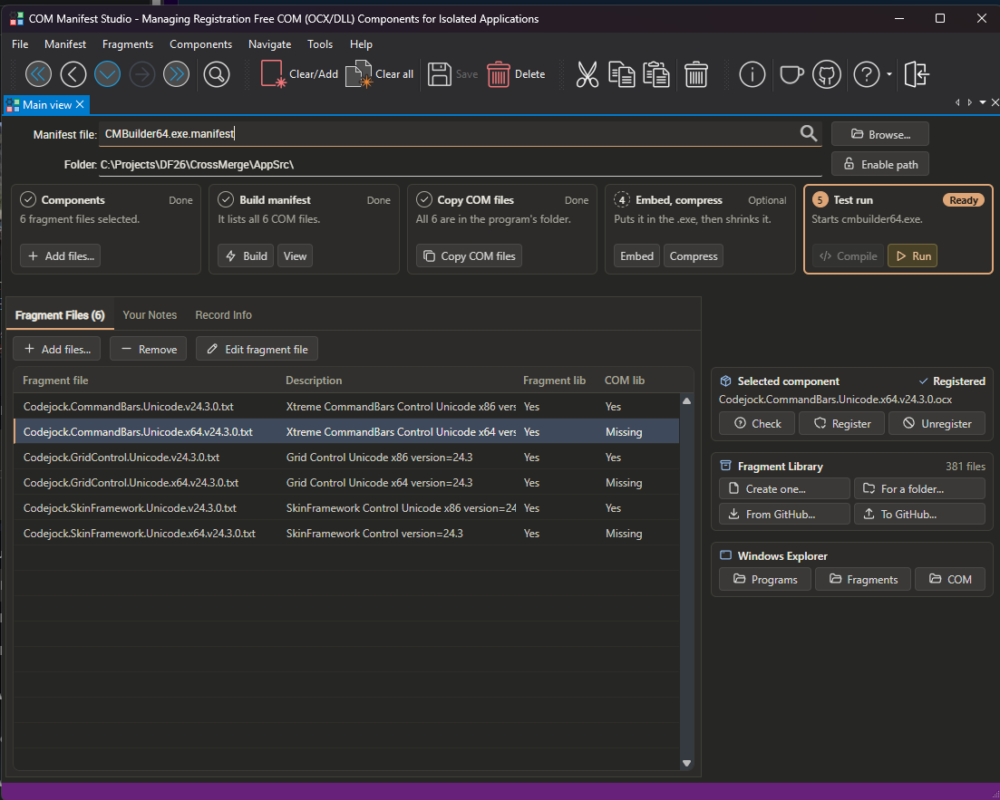

**COM Manifest Studio**

**Program Purpose:**

COMManifestStudio is a specialized tool designed for the efficient management of Registration-Free Component Object Model (COM) components, specifically OCX and DLL files, which are used in isolated applications. The primary function of this software is to create .manifest project files tailored for selected COM/DLL components. This tool is developed using DataFlex, a highly efficient programming language known for its data handling capabilities.



**Important Note:** Compiling the program as a 32-bit application is crucial. Failure to do so may lead to ineffective communication with the COM components, resulting in errors or malfunctions in the application. Ensuring that the correct compilation settings are in place will promote smooth operation and prevent potential issues.

This is a DataFlex 26 workspace. It leverages various additional libraries hosted on [NilsSve's GitHub page](https://github.com/NilsSve). You do not need to fetch or manage any of them — the Studio does it for you the first time it opens the workspace.

## Opening the workspace

Open **`COMManifestStudio.sws`** in DataFlex 26 and build. That is the whole
procedure; there is no setup step to run first.

The libraries this workspace uses — Filesystem, DUF, DFAbout, RDCToolsLib,
vwin32fh and DFUnit (for the unit tests) — are not stored in this repository. They are dependencies of the
workspace, each pinned to an exact commit in `COMManifestStudio.sws.lock`, and
the Studio's package handler fetches them into `DfPkg\` when the workspace is
first opened. Give it a moment before the first compile. `DfPkg\` is local-only
and is never committed; the lock file is committed, and is what makes your clone
build the same library versions as everyone else's.

Remember to compile as 32-bit — see the note above.

### If you are going to commit here

Run **`setup.bat`** once. It does one thing: it calls `skip-local-data.cmd`, so
that git ignores your own changes to the baseline database under `Data\` and you
cannot push them by accident. If you are only running the program, you can skip
it.

## Building from the command line

COM Manifest Studio can build a program's manifest without a window, for a build script or a build server:

```
COMManifestStudio.exe /build <program.exe> [/copy] [/compile] [/embed] [/log <file>]
```

- **The manifest** is always built and checked with `mt.exe`, from the COM components the program's manifest lists in COM Manifest Studio. Open the program's manifest in the program once and add its components; after that the build needs no window.
- `/copy` copies the COM files that are missing from the program's folder.
- `/compile` compiles the program again, with the DataFlex version its workspace is for. When the program's project settings embed the manifest (`EmbedManifestFile=1` in its `.cfg`), the compiler puts the manifest into the program as it builds it.
- `/embed` puts the manifest into the finished program with `mt.exe`.
- `/log <file>` writes the log there. Without it, the log is `<program>.manifest-build.log` beside the program. It holds every message the program would have shown, and every question with the answer the build gave it.

The exit code is 0 when everything asked for was done and checked, 1 when a step failed, and 2 when the build could not start (no such program, or no manifest for it in COM Manifest Studio).

**Use `/compile` rather than `/embed`.** `/embed` rewrites a finished program file, and that is what some malware does, so an antivirus program can refuse it: Windows Defender reported `mt.exe`'s rewrite of a DataFlex program as Worm:Win32/Mofksys!pz. The compiler writes the program with the manifest in it in the first place, which no antivirus program objects to. When `mt.exe` is refused, COM Manifest Studio says so and suggests compiling.

## Unit tests

`AppSrc\UnitTests.src` is the unit-test program of the workspace, built on
[DFUnit](https://github.com/NilsSve/Library-DFUnit), which the workspace takes as a package like the other
libraries. The tests are in `AppSrc\o<Subject>-Tests.pkg`, one file per subject, and `AppSrc\oUnit_Tests.pkg`
lists them. The first file covers the parts of `cManifestFunctionLibrary` that need no database, no window and
no COM component: git's name for a file's content (how the program tells a changed fragment file), the
platform a program file is built for, and the small text helpers.

Like the program itself, the test program is 32-bit. Build it in the Studio, or from a command prompt:

```
df-cli build --target UnitTests COMManifestStudio.sws
Programs\UnitTests.exe -c
```

`-c` runs the tests on the console and ends with exit code 0 when all passed; without it the test-runner window
opens.
